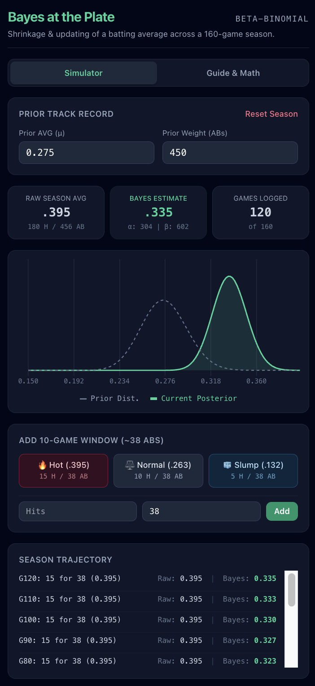

# Bayes at the Plate: Empirical Bayes Batting Average Tracker



Welcome to **Bayes at the Plate**!

Have you ever seen a baseball player hit 4-for-10 in the first week of April and lead the league with a blistering **.400 batting average**? Does anyone actually believe they are going to hit .400 for the entire season and break Ted Williams' 1941 record?

Of course not. But why? 

Because we instinctively know that **10 at-bats is too small a sample**. If you flip a normal coin 10 times and get 7 heads (70%), you don't declare that the coin is broken or weighted. You recognize that small samples have huge random streaks.

In statistics, this is called **small-sample noise**. **Bayes at the Plate** is an interactive web app that demonstrates how Major League front offices use **Empirical Bayes (Beta-Binomial Conjugate Updating)** to filter out early-season noise and calculate a player's **true underlying talent**.

---

## App Modes & Top Navigation

The top of the app features a segmented navigation toggle:

```
┌──────────────────────────────────────────────┐
│  [ Simulator ]         [ Guide & Math ]      │
└──────────────────────────────────────────────┘
```

* **Simulator Tab:** The interactive tracking engine where you set a player's prior track record, advance through a 160-game season in 10-game increments (hot streaks, cold slumps, or custom inputs), and watch the probability density curve shift and narrow in real time.
* **Guide & Math Tab:** An embedded, self-contained educational guide explaining the coin-toss paradox, how Beta parameters ($\alpha$ and $\beta$) represent real "pseudo-at-bats", and the exact precision-weighting formula behind Bayesian shrinkage.

---

## Tour of the Simulator

```
┌─────────────────────────────────────────────────────────────┐
│ 1. PRIOR TRACK RECORD (Career Baseline)                    │
├─────────────────────────────────────────────────────────────┤
│ 2. KEY STATS RIBBON (Raw vs. Bayes Estimate)                │
├─────────────────────────────────────────────────────────────┤
│ 3. DYNAMIC CHART CANVAS (Prior vs. Posterior Curve)         │
├─────────────────────────────────────────────────────────────┤
│ 4. 10-GAME DATA ENTRY (Hot, Normal, Slump, Custom)          │
├─────────────────────────────────────────────────────────────┤
│ 5. SEASON TRAJECTORY (Game-by-Game Audit Log)               │
└─────────────────────────────────────────────────────────────┘
```

### 1. Prior Track Record (The Anchor)
* **Prior AVG ($\mu$):** The player's established career ability before the season starts (default: `.275`).
* **Prior Weight (ABs):** The historical strength or confidence in that prior (default: `450` at-bats).
  * This translates directly into mathematical pseudo-counts:
    * $\alpha_0 = 0.275 \times 450 \approx \mathbf{124\text{ pseudo-hits}}$
    * $\beta_0 = (1 - 0.275) \times 450 \approx \mathbf{326\text{ pseudo-outs}}$
* **Reset Season:** Resets the season clock to Opening Day (Game 0).

### 2. Key Stats Ribbon
* **Raw Season AVG:** The traditional box-score batting average ($\text{Hits} / \text{At-Bats}$). Notice how wildly volatile it is in April!
* **Bayes Estimate:** The true Bayesian expected batting average. Notice how it resists wild swings and stays grounded in reality.
* **Games Logged:** Progress tracker counting up to a standard 160-game Major League schedule.

### 3. Dynamic Chart Canvas (Chart.js)
* **Gray Dashed Curve (Prior Dist.):** Represents where a typical player of this caliber should land before seeing any pitches this season.
* **Emerald Solid Curve (Current Posterior):** The updated probability distribution of the player's true skill.
  * Notice how it starts wide (uncertain) and becomes **taller and narrower** as more at-bats are logged over the summer.

### 4. 10-Game Progression Controls
* **🔥 Hot (.395):** Adds 15 hits in 38 at-bats.
* **⚖️ Normal (.263):** Adds 10 hits in 38 at-bats.
* **🧊 Slump (.132):** Adds 5 hits in 38 at-bats.
* **Custom:** Enter exact Hits and ABs to simulate any real-world box score.

### 5. Season Trajectory Log
Records every 10-game window side-by-side, displaying the raw stretch, the cumulative raw average, and the stabilized Bayesian talent estimate.

---

## The Math: Beta-Binomial Conjugacy

Unlike complex Markov Chain Monte Carlo (MCMC) simulations, Beta-Binomial updating is **closed-form** (simple grade-school addition):

$$\alpha_{\text{current}} = \alpha_0 + \text{Cumulative Hits}$$

$$\beta_{\text{current}} = \beta_0 + (\text{Cumulative At-Bats} - \text{Cumulative Hits})$$

The updated Bayes estimate is simply the mean of the new Beta distribution:

$$\text{Bayes AVG} = \frac{\alpha_{\text{current}}}{\alpha_{\text{current}} + \beta_{\text{current}}}$$

### Shrinkage as a Weighted Average

Bayesian updating is identical to calculating a **weighted average** between past career ability and current in-season performance:

$$\text{Bayes AVG} = (1 - w) \times \text{Prior AVG} + w \times \text{Raw Season AVG}$$

where:

$$w = \frac{\text{Season At-Bats}}{\text{Season At-Bats} + \text{Prior Weight (450)}}$$

* **At Game 10 (38 ABs):** $w = \frac{38}{38 + 450} \approx \mathbf{7.8\%}$. Even with a blazing .395 streak, the raw data only gets 7.8% weight. The Bayes estimate shrinks back to **.284**.
* **At Game 110 (418 ABs):** $w = \frac{418}{418 + 450} \approx \mathbf{48.2\%}$. With 400+ at-bats in the books, the evidence carries nearly equal weight to 3 years of career history, pulling the estimate up to **.333**.

---

## 3 Experiments to Try

1. **The April Mirage:** Start at Game 0 and hit **🔥 Hot** once (Game 10). Notice how the Raw Average screams `.395`, but the Bayes estimate barely budges to `.284`.
2. **The Relentless Streak:** Click **🔥 Hot** 10 times in a row until Game 100. Watch the emerald bell curve march steadily to the right and narrow dramatically. By July, Bayes admits this player has genuinely leveled up!
3. **The Power of Priors:** Change the Prior Weight from `450` down to `50` (a rookie with no track record). Repeat Experiment 1 and watch how much faster the Bayes estimate jumps when there is little prior history to anchor it.
